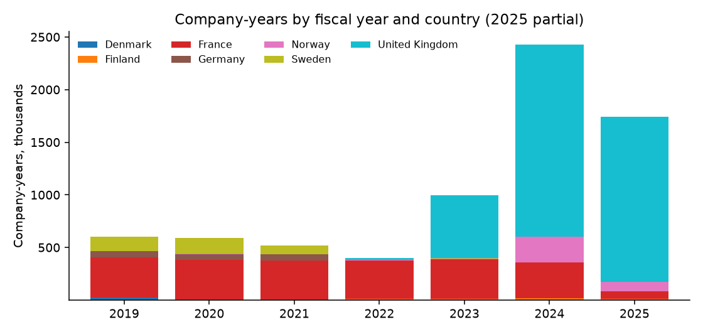
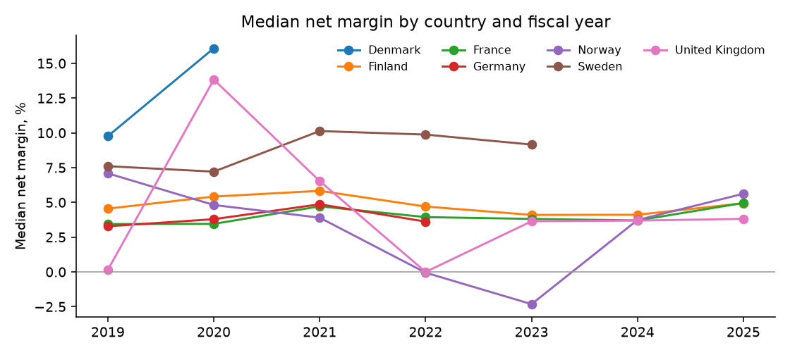
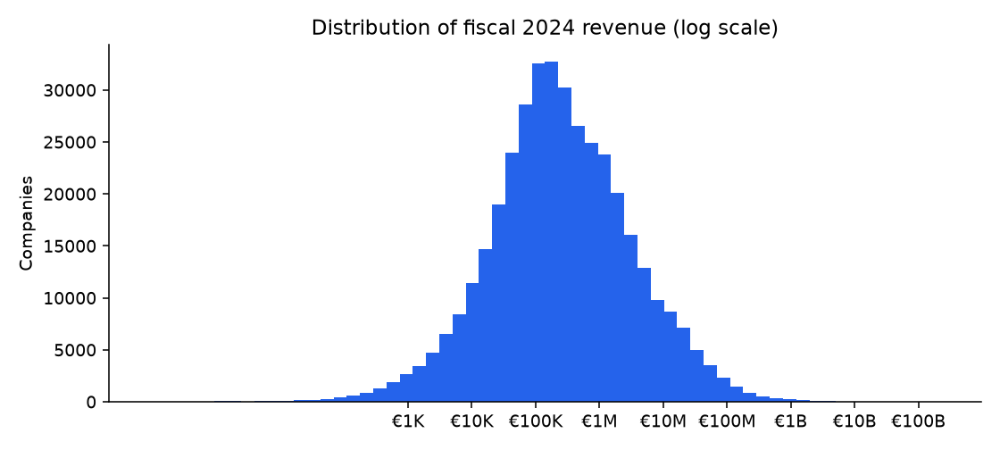

# European Company Financials 2019–2025: findings, method and data card

*Fliar Research · released October 2026 · licence CC BY-NC 4.0*

**How this dataset was acquired.** Every row comes from the [Radar API](https://github.com/fliarbi/radar-api-mcp), Fliar's company-data API and MCP server. Radar
collects the annual accounts that companies file with public company registries in the United Kingdom, France, Norway, Denmark,
Sweden, Finland and Germany, reads the structured (XBRL / iXBRL / ESEF) and published financial statements, and maps each line to a
common set of metrics. This release keeps one row per company and fiscal year (2019–2025) with five headline figures: revenue, net
income, equity, total assets and employees, in the filing currency plus a euro conversion of revenue. Every figure passed sanity
checks against the rest of the same filing. Rows are linked to the company's website where Radar can match it. The full statements
(cost lines, cash flow, debt and more, for every company) are available through `POST /v1/companies/financials`
([reference](https://github.com/fliarbi/radar-api-mcp/blob/main/docs/reference/get_financials.md)) or the `get_financials` MCP tool.

> **This file is a 1% sample: 100,001 of 7,275,327 company-years.** It keeps every record for a fixed subset of companies.
> The subset is chosen by a hash, so it stays the same from one release to the next. The findings and tables below were computed
> on the **full** data. For the rest, the withheld fields and monthly updates, [get a Radar API key](https://fliarbi.com/radar-api/developer) ([docs](https://github.com/fliarbi/radar-api-mcp)).
> Each row's `fliar_profile_url` opens the company's full profile on Fliar.

## Key findings

1. **7,275,327 company-years for 3,620,213 companies in seven countries, fiscal years 2019 to 2025.** The United Kingdom (2,064,089 companies) and France (933,682) are the largest groups.
2. **Revenue is filed for 42% of company-years.** Coverage runs from France 100%, Sweden 88%, Finland 85%, Norway 77%, Denmark 17%, Germany 6%, United Kingdom 3%. Most UK rows are balance sheets (equity, assets, headcount) without revenue or profit.
3. **The median company earned a net margin of 4.2%** (company-years with revenue and profit filed, n = 1,981,379); 26% of them reported a loss.
4. **Revenue is highly concentrated.** In fiscal 2024 the top 1% of companies by revenue (5,855 companies) account for 81% of the €5.0T filed revenue in the data.
5. **Among 40,193 companies with revenue of at least €1M in both 2023 and 2024, the median grew 1.7%**; 56% grew and 4% grew by half or more.
6. **Median revenue per employee** (company-years with both filed): Denmark €87.2K, Sweden €80.6K, United Kingdom €48.1K.

### Company-years by country and fiscal year

Full data. Recent years fill in as accounts are filed, so 2025 is partial; the years covered differ by country (see Limitations).

| Country        | 2019    | 2020    | 2021    | 2022    | 2023    | 2024      | 2025      | Companies   |
|:---------------|:--------|:--------|:--------|:--------|:--------|:----------|:----------|:------------|
| Denmark        | 24,993  | 2,089   | 12      | 15      | 13      | 1         | 0         | 25,171      |
| Finland        | 1,352   | 3,670   | 6,771   | 9,819   | 13,009  | 14,948    | 11,471    | 18,153      |
| France         | 381,149 | 375,382 | 371,341 | 363,901 | 376,469 | 341,736   | 71,175    | 933,682     |
| Germany        | 55,425  | 56,856  | 58,171  | 4,062   | 0       | 0         | 0         | 69,631      |
| Norway         | 180     | 253     | 343     | 791     | 2,689   | 243,995   | 92,598    | 340,840     |
| Sweden         | 136,608 | 149,306 | 81,818  | 5,807   | 5,422   | 4         | 3         | 168,647     |
| United Kingdom | 686     | 1,101   | 2,134   | 12,444  | 599,268 | 1,828,716 | 1,567,331 | 2,064,089   |

### Which figures each country files

Share of company-years where each figure is present after the sanity checks.

| Country        | Company-years   | Companies   | Revenue   | Net income   | Equity   | Total assets   | Employees   | Linked website   |
|:---------------|:----------------|:------------|:----------|:-------------|:---------|:---------------|:------------|:-----------------|
| United Kingdom | 4,011,680       | 2,064,089   | 2.6%      | 3.9%         | 80.5%    | 76.0%          | 79.5%       | 2.9%             |
| France         | 2,281,153       | 933,682     | 99.9%     | 98.9%        | 0.0%     | 0.0%           | 0.0%        | 0.1%             |
| Sweden         | 378,968         | 168,647     | 88.5%     | 95.1%        | 93.4%    | 93.9%          | 55.3%       | 0.3%             |
| Norway         | 340,849         | 340,840     | 77.4%     | 99.2%        | 99.3%    | 99.7%          | 0.0%        | 1.1%             |
| Germany        | 174,514         | 69,631      | 6.4%      | 48.2%        | 76.1%    | 56.3%          | 0.0%        | 0.0%             |
| Finland        | 61,040          | 18,153      | 84.7%     | 95.7%        | 96.1%    | 99.7%          | 0.0%        | 0.0%             |
| Denmark        | 27,123          | 25,171      | 16.6%     | 94.5%        | 99.2%    | 99.7%          | 50.5%       | 2.5%             |

### Revenue distribution by band, fiscal 2023–2024

Company-years with revenue filed, converted to euro at fixed 2024 rates.

| Revenue band (EUR)   | United Kingdom   | France   | Sweden   | Norway   | Finland   | Denmark   | All     | Share   |
|:---------------------|:-----------------|:---------|:---------|:---------|:----------|:----------|:--------|:--------|
| under €100K          | 41,314           | 436,003  | 3,158    | 86,934   | 10,296    | 6         | 577,711 | 58.0%   |
| €100K–1M             | 9,855            | 137,734  | 1,588    | 65,287   | 10,849    | 3         | 225,316 | 22.6%   |
| €1M–10M              | 4,154            | 102,448  | 183      | 28,705   | 2,429     | 0         | 137,919 | 13.8%   |
| €10M–50M             | 6,392            | 28,869   | 10       | 4,357    | 110       | 2         | 39,740  | 4.0%    |
| €50M–250M            | 1,113            | 9,855    | 1        | 1,144    | 6         | 3         | 12,122  | 1.2%    |
| €250M–1B             | 97               | 1,916    | 2        | 213      | 0         | 0         | 2,228   | 0.2%    |
| €1B–10B              | 11               | 700      | 2        | 67       | 0         | 0         | 780     | 0.1%    |
| €10B+                | 2                | 108      | 1        | 3        | 0         | 0         | 114     | 0.0%    |

### Largest companies by revenue, fiscal 2024 (top 50)

Entity-level accounts as filed: a group can appear through its holding company and its subsidiaries, and consolidated figures are used where the filing has them.

| #   | Company                                        | Country        | Year end   | Revenue   | Net income   | Net margin   | Total assets   | Employees   |
|:----|:-----------------------------------------------|:---------------|:-----------|:----------|:-------------|:-------------|:---------------|:------------|
| 1   | BONNEUIL EXPANSION                             | France         | 2024-03-31 | €230.0B   | €3.6B        | 1.6%         |                |             |
| 2   | TOTALENERGIES SE                               | France         | 2024-12-31 | €214.6B   | €16.0B       | 7.5%         |                |             |
| 3   | ELECTRICITE DE FRANCE                          | France         | 2024-12-31 | €118.7B   | €11.9B       | 10.0%        |                |             |
| 4   | FINANCIERE AGACHE                              | France         | 2024-12-31 | €84.7B    | €12.8B       | 15.1%        |                |             |
| 5   | LVMH MOET HENNESSY LOUIS VUITTON               | France         | 2024-12-31 | €84.7B    | €13.0B       | 15.3%        |                |             |
| 6   | Equinor ASA                                    | Norway         | 2024-12-31 | €66.7B    | €7.5B        | 11.2%        | €100.4B        |             |
| 7   | AIRBUS                                         | France         | 2024-12-31 | €57.4B    | €2.2B        | 3.8%         |                |             |
| 8   | RENAULT                                        | France         | 2024-12-31 | €56.2B    | €891.0M      | 1.6%         |                |             |
| 9   | RENAULT SAS                                    | France         | 2024-12-31 | €52.5B    | €2.7B        | 5.1%         |                |             |
| 10  | COMPAGNIE DE SAINT-GOBAIN                      | France         | 2024-12-31 | €46.6B    | €2.9B        | 6.3%         |                |             |
| 11  | VEOLIA ENVIRONNEMENT                           | France         | 2024-12-31 | €44.7B    | €1.4B        | 3.2%         |                |             |
| 12  | L'OREAL                                        | France         | 2024-12-31 | €43.5B    | €0           | 0.0%         |                |             |
| 13  | LES MOUSQUETAIRES                              | France         | 2024-12-31 | €42.9B    | €59.3M       | 0.1%         |                |             |
| 14  | FOURNIER GROUP                                 | France         | 2024-12-31 | €39.4B    | €-22.3B      | -56.5%       |                |             |
| 15  | CREDIT AGRICOLE SA                             | France         | 2024-12-31 | €38.1B    | €9.5B        | 25.0%        |                |             |
| 16  | EQUINOR ENERGY AS                              | Norway         | 2024-12-31 | €34.8B    | €7.1B        | 20.3%        | €61.2B         |             |
| 17  | LA POSTE                                       | France         | 2024-12-31 | €34.6B    | €1.7B        | 5.0%         |                |             |
| 18  | ELO                                            | France         | 2024-12-31 | €32.3B    | €-1.2B       | -3.8%        |                |             |
| 19  | COMPAGNIE DE L'ODET                            | France         | 2024-12-31 | €31.3B    | €17.5B       | 55.9%        |                |             |
| 20  | JAGUAR LAND ROVER LIMITED                      | United Kingdom | 2024-03-31 | €30.4B    |              |              | €11.5B         |             |
| 21  | B.S.A                                          | France         | 2024-12-31 | €30.3B    | €45.0M       | 0.1%         |                |             |
| 22  | GROUPE ADEO                                    | France         | 2024-12-31 | €30.1B    | €377.5M      | 1.3%         |                |             |
| 23  | COMPAGNIE GENERALE DES ETABLISSEMENTS MICHELIN | France         | 2024-12-31 | €27.2B    | €1.9B        | 7.0%         |                |             |
| 24  | FORVIA                                         | France         | 2024-12-31 | €27.0B    | €-24.2M      | -0.1%        |                |             |
| 25  | ESSILORLUXOTTICA                               | France         | 2024-12-31 | €26.5B    | €2.5B        | 9.4%         |                |             |
| 26  | EIFFAGE                                        | France         | 2024-12-31 | €24.0B    | €0           | 0.0%         |                |             |
| 27  | CSF                                            | France         | 2024-12-31 | €23.9B    | €223.7M      | 0.9%         |                |             |
| 28  | ITM ALIMENTAIRE INTERNATIONAL                  | France         | 2024-12-31 | €22.7B    | €-437.5M     | -1.9%        |                |             |
| 29  | CAPGEMINI                                      | France         | 2024-12-31 | €22.5B    | €10.0M       | 0.0%         |                |             |
| 30  | VALEO                                          | France         | 2024-12-31 | €21.5B    | €234.0M      | 1.1%         |                |             |
| 31  | SOGECAP                                        | France         | 2024-12-31 | €20.5B    | €454.7M      | 2.2%         |                |             |
| 32  | TECHWOOD                                       | France         | 2024-08-31 | €20.3B    | €1.0B        | 5.0%         |                |             |
| 33  | REXEL                                          | France         | 2024-12-31 | €19.3B    | €341.0M      | 1.8%         |                |             |
| 34  | SOCIETE AIR FRANCE                             | France         | 2024-12-31 | €19.2B    | €147.0M      | 0.8%         |                |             |
| 35  | SOC D'IMPORTATION LECLERC                      | France         | 2024-12-31 | €18.7B    | €-1.0M       | -0.0%        |                |             |
| 36  | ENEDIS                                         | France         | 2024-12-31 | €16.9B    | €661.0M      | 3.9%         |                |             |
| 37  | SCOR SE                                        | France         | 2024-12-31 | €16.1B    | €4.0M        | 0.0%         |                |             |
| 38  | COLAS SA                                       | France         | 2024-12-31 | €15.9B    | €314.0M      | 2.0%         |                |             |
| 39  | COOPERATIVE U                                  | France         | 2024-12-31 | €15.5B    | €0           | 0.0%         |                |             |
| 40  | SINERGY                                        | France         | 2024-12-31 | €15.4B    | €0           | 0.0%         |                |             |
| 41  | PUBLICIS GROUPE S.A.                           | France         | 2024-12-31 | €14.0B    | €0           | 0.0%         |                |             |
| 42  | AUCHAN HYPERMARCHE                             | France         | 2024-12-31 | €13.6B    | €-369.3M     | -2.7%        |                |             |
| 43  | AIRBUS OPERATIONS                              | France         | 2024-12-31 | €13.2B    | €1.8B        | 13.4%        |                |             |
| 44  | AUTOMOBILES PEUGEOT                            | France         | 2024-12-31 | €12.9B    | €-259.1M     | -2.0%        |                |             |
| 45  | TOTALENERGIES ELECTRICITE ET GAZ FRANCE        | France         | 2024-12-31 | €12.0B    | €661.0M      | 5.5%         |                |             |
| 46  | CARREFOUR HYPERMARCHES                         | France         | 2024-12-31 | €11.8B    | €-408.1M     | -3.5%        |                |             |
| 47  | SUCRES ET DENREES                              | France         | 2024-12-31 | €11.6B    | €0           | 0.0%         |                |             |
| 48  | PERNOD RICARD                                  | France         | 2024-06-30 | €11.6B    | €1.5B        | 13.1%        |                |             |
| 49  | Hydro Norge                                    | Norway         | 2024-12-31 | €11.4B    | €1.7B        | 14.7%        | €38.8B         |             |
| 50  | AYVENS                                         | France         | 2024-12-31 | €11.0B    | €0           | 0.0%         |                |             |

### Most profitable companies, fiscal 2024 (top 50 by net income)

| #   | Company                                        | Country        | Year end   | Revenue   | Net income   | Net margin   | Total assets   | Employees   |
|:----|:-----------------------------------------------|:---------------|:-----------|:----------|:-------------|:-------------|:---------------|:------------|
| 1   | COMPAGNIE DE L'ODET                            | France         | 2024-12-31 | €31.3B    | €17.5B       | 55.9%        |                |             |
| 2   | TOTALENERGIES SE                               | France         | 2024-12-31 | €214.6B   | €16.0B       | 7.5%         |                |             |
| 3   | LVMH MOET HENNESSY LOUIS VUITTON               | France         | 2024-12-31 | €84.7B    | €13.0B       | 15.3%        |                |             |
| 4   | FINANCIERE AGACHE                              | France         | 2024-12-31 | €84.7B    | €12.8B       | 15.1%        |                |             |
| 5   | ELECTRICITE DE FRANCE                          | France         | 2024-12-31 | €118.7B   | €11.9B       | 10.0%        |                |             |
| 6   | BRØDRENE KARLSEN HOLDING AS                    | Norway         | 2024-12-31 |           | €11.8B       |              | €132.5B        |             |
| 7   | CREDIT AGRICOLE SA                             | France         | 2024-12-31 | €38.1B    | €9.5B        | 25.0%        |                |             |
| 8   | Equinor ASA                                    | Norway         | 2024-12-31 | €66.7B    | €7.5B        | 11.2%        | €100.4B        |             |
| 9   | EQUINOR ENERGY AS                              | Norway         | 2024-12-31 | €34.8B    | €7.1B        | 20.3%        | €61.2B         |             |
| 10  | LOUIS VUITTON MALLETIER                        | France         | 2024-12-31 | €11.0B    | €6.6B        | 60.6%        |                |             |
| 11  | HERMES INTERNATIONAL                           | France         | 2024-12-31 | €678.0M   | €4.0B        | 589.7%       |                |             |
| 12  | ALDER PARIS HOLDINGS SAS                       | France         | 2024-11-30 | €0        | €3.9B        |              |                |             |
| 13  | BONNEUIL EXPANSION                             | France         | 2024-03-31 | €230.0B   | €3.6B        | 1.6%         |                |             |
| 14  | COMPAGNIE DE SAINT-GOBAIN                      | France         | 2024-12-31 | €46.6B    | €2.9B        | 6.3%         |                |             |
| 15  | RENAULT SAS                                    | France         | 2024-12-31 | €52.5B    | €2.7B        | 5.1%         |                |             |
| 16  | ESSILORLUXOTTICA                               | France         | 2024-12-31 | €26.5B    | €2.5B        | 9.4%         |                |             |
| 17  | ABN AMRO BANK NV                               | France         | 2024-12-31 | €6.5B     | €2.4B        | 37.0%        |                |             |
| 18  | AIRBUS                                         | France         | 2024-12-31 | €57.4B    | €2.2B        | 3.8%         |                |             |
| 19  | CHRISTIAN DIOR COUTURE                         | France         | 2024-12-31 | €4.4B     | €2.0B        | 45.0%        |                |             |
| 20  | CREDIT AGRICOLE ASSURANCES                     | France         | 2024-12-31 | €2.8B     | €2.0B        | 68.9%        |                |             |
| 21  | COMPAGNIE GENERALE DES ETABLISSEMENTS MICHELIN | France         | 2024-12-31 | €27.2B    | €1.9B        | 7.0%         |                |             |
| 22  | SCHNEIDER ELECTRIC INDUSTRIES SAS              | France         | 2024-12-31 | €4.4B     | €1.8B        | 41.0%        |                |             |
| 23  | Telenor ASA                                    | Norway         | 2024-12-31 | €58.3M    | €1.8B        | 3027.3%      | €18.2B         |             |
| 24  | AIRBUS OPERATIONS                              | France         | 2024-12-31 | €13.2B    | €1.8B        | 13.4%        |                |             |
| 25  | LA POSTE                                       | France         | 2024-12-31 | €34.6B    | €1.7B        | 5.0%         |                |             |
| 26  | Hydro Norge                                    | Norway         | 2024-12-31 | €11.4B    | €1.7B        | 14.7%        | €38.8B         |             |
| 27  | PERNOD RICARD                                  | France         | 2024-06-30 | €11.6B    | €1.5B        | 13.1%        |                |             |
| 28  | VEOLIA ENVIRONNEMENT                           | France         | 2024-12-31 | €44.7B    | €1.4B        | 3.2%         |                |             |
| 29  | AMUNDI                                         | France         | 2024-12-31 | €3.4B     | €1.3B        | 38.2%        |                |             |
| 30  | CREDIT INDUSTRIEL ET COMMERCIAL                | France         | 2024-12-31 | €2.5B     | €1.3B        | 51.3%        |                |             |
| 31  | LEGRAND                                        | France         | 2024-12-31 | €8.6B     | €1.2B        | 13.5%        |                |             |
| 32  | XPFIBRE HOLDING                                | France         | 2024-12-31 | €0        | €1.1B        |              |                |             |
| 33  | Norsk Hydro ASA                                | Norway         | 2024-12-31 | €7.7M     | €1.1B        | 14373.0%     | €8.7B          |             |
| 34  | HYDRO ALUMINIUM AS                             | Norway         | 2024-12-31 | €6.0B     | €1.1B        | 18.1%        | €9.3B          |             |
| 35  | COGAC                                          | France         | 2024-12-31 | €0        | €1.1B        |              |                |             |
| 36  | ALLERGAN HOLDINGS FRANCE                       | France         | 2024-12-31 | €0        | €1.1B        |              |                |             |
| 37  | TECHWOOD                                       | France         | 2024-08-31 | €20.3B    | €1.0B        | 5.0%         |                |             |
| 38  | TELENOR ASIA HOLDING AS                        | Norway         | 2024-12-31 |           | €1.0B        |              | €6.8B          |             |
| 39  | WENDEL                                         | France         | 2024-12-31 | €8.3B     | €989.9M      | 12.0%        |                |             |
| 40  | WENDEL-PARTICIPATIONS SE                       | France         | 2024-12-31 | €8.3B     | €987.9M      | 12.0%        |                |             |
| 41  | INFRANORD SA                                   | Norway         | 2024-12-31 | €2.4B     | €987.7M      | 42.0%        | €85.8B         |             |
| 42  | RCI BANQUE                                     | France         | 2024-12-31 | €2.2B     | €981.0M      | 45.0%        |                |             |
| 43  | TSYS International Management Limited          | United Kingdom | 2024-12-31 |           | €975.5M      |              | €2.3B          | 1           |
| 44  | SG FINANCIAL SERVICES HOLDING                  | France         | 2024-12-31 | €0        | €945.8M      |              |                |             |
| 45  | UNIBAIL-RODAMCO-WESTFIELD SE                   | France         | 2024-12-31 | €198.0M   | €943.2M      | 476.3%       |                |             |
| 46  | LEGRAND FRANCE                                 | France         | 2024-12-31 | €1.0B     | €936.0M      | 92.0%        |                |             |
| 47  | TOTALENERGIES EP NORGE AS                      | Norway         | 2024-12-31 | €5.9B     | €931.9M      | 15.7%        | €7.7B          |             |
| 48  | DASSAULT AVIATION                              | France         | 2024-12-31 | €6.2B     | €923.8M      | 14.8%        |                |             |
| 49  | CHANEL                                         | France         | 2024-12-31 | €4.2B     | €904.6M      | 21.7%        |                |             |
| 50  | ORKLA ASA                                      | Norway         | 2024-12-31 | €25.1M    | €891.1M      | 3548.6%      | €7.4B          |             |

### Net margin and balance-sheet strength by country

Company-years with both revenue (> 0) and net income filed.

| Country        | Company-years   | Median revenue   | Median net margin   | 25th pct   | 75th pct   | Margin 2022   | Margin 2024   | Loss-making   | Median equity / assets   |
|:---------------|:----------------|:-----------------|:--------------------|:-----------|:-----------|:--------------|:--------------|:--------------|:-------------------------|
| France         | 1,340,568       | €392.9K          | 3.8%                | -0.1%      | 13.3%      | 3.9%          | 3.7%          | 25.3%         |                          |
| Sweden         | 268,070         | €80.3K           | 8.0%                | 0.0%       | 25.5%      | 9.9%          |               | 23.9%         | 55.9%                    |
| Norway         | 226,558         | €169.3K          | 4.2%                | -4.9%      | 21.2%      | -0.1%         | 3.7%          | 34.0%         | 43.0%                    |
| United Kingdom | 87,215          | €50.9K           | 3.7%                | -3.3%      | 23.8%      | 0.0%          | 3.7%          | 31.8%         | 34.9%                    |
| Finland        | 49,425          | €143.4K          | 4.6%                | -1.8%      | 17.1%      | 4.7%          | 4.1%          | 29.5%         | 52.3%                    |
| Germany        | 6,417           | €24.7M           | 3.9%                | 0.9%       | 11.9%      | 3.6%          |               | 8.4%          | 45.5%                    |
| Denmark        | 3,126           | €74.9K           | 10.1%               | -0.4%      | 49.9%      |               |               | 25.8%         | 55.5%                    |

### Profitability by company size, fiscal 2023–2024

| Revenue band (EUR)   | Company-years   | Median net margin   | Loss-making   | Median employees   | Median total assets   |
|:---------------------|:----------------|:--------------------|:--------------|:-------------------|:----------------------|
| under €100K          | 197,357         | 3.0%                | 41.4%         | 1                  | €40.7K                |
| €100K–1M             | 223,857         | 5.0%                | 26.1%         | 2                  | €246.9K               |
| €1M–10M              | 137,488         | 3.6%                | 21.3%         | 15                 | €1.4M                 |
| €10M–50M             | 39,625          | 2.8%                | 19.0%         | 66                 | €10.7M                |
| €50M–250M            | 12,088          | 2.2%                | 18.5%         | 119                | €39.6M                |
| €250M–1B             | 2,220           | 1.8%                | 19.5%         | 269                | €218.5M               |
| €1B–10B              | 778             | 1.8%                | 15.2%         | 30                 | €943.0M               |
| €10B+                | 111             | 1.1%                | 14.4%         |                    | €61.2B                |

### Fastest-growing companies 2023 → 2024 (top 50, revenue ≥ €10M in 2023)

Same company and same accounts basis (single-entity or consolidated) in both years, revenue converted at the same fixed rate so currency moves do not count as growth. Growth above 5× is left out as a likely change of scope or units; remaining jumps can reflect acquisitions.

| #   | Company                              | Country        | Revenue 2023   | Revenue 2024   | Growth   | Net income 2024   | Employees 2024   |
|:----|:-------------------------------------|:---------------|:---------------|:---------------|:---------|:------------------|:-----------------|
| 1   | SONAUTO ROISSY                       | France         | €49.4M         | €239.9M        | 386.0%   | €6.9M             |                  |
| 2   | T.EN ENGINEERING                     | France         | €58.7M         | €271.0M        | 361.5%   | €16.4M            |                  |
| 3   | CL DUNKERQUE                         | France         | €21.8M         | €98.2M         | 350.4%   | €1.6M             |                  |
| 4   | NDK                                  | France         | €10.8M         | €45.8M         | 325.0%   | €171.5K           |                  |
| 5   | DISTRITOYS HOLDING                   | France         | €109.7M        | €461.0M        | 320.3%   | €277.0K           |                  |
| 6   | MS GLOBAL SHIPPING LLP               | United Kingdom | €61.6M         | €255.7M        | 315.0%   | €-325.2K          | 0                |
| 7   | COMAU U.K. LIMITED                   | United Kingdom | €20.6M         | €84.6M         | 310.8%   | €10.8M            | 57               |
| 8   | VEGETRADE                            | France         | €31.1M         | €122.7M        | 294.4%   | €592.0K           |                  |
| 9   | GREENYELLOW                          | France         | €39.2M         | €147.7M        | 277.0%   | €-21.7M           |                  |
| 10  | POLY 2025                            | France         | €70.3M         | €263.7M        | 274.9%   | €21.4M            |                  |
| 11  | BEONE MEDICINES FRANCE SARL          | France         | €20.3M         | €75.6M         | 272.5%   | €1.3M             |                  |
| 12  | IZI SOLUTIONS DURABLES               | France         | €19.0M         | €70.7M         | 272.0%   | €-7.3M            |                  |
| 13  | LIDS HOLDINGS FRANCE                 | France         | €15.2M         | €54.0M         | 254.8%   | €-1.0M            |                  |
| 14  | ALCOME                               | France         | €15.7M         | €54.9M         | 248.8%   | €0                |                  |
| 15  | ACTION PIN                           | France         | €16.4M         | €55.7M         | 239.6%   | €3.2M             |                  |
| 16  | SOUTHEY CAPITAL LTD                  | United Kingdom | €36.6M         | €123.9M        | 238.5%   | €694.9K           | 1                |
| 17  | INELFE                               | France         | €98.4M         | €311.8M        | 217.0%   | €2.0M             |                  |
| 18  | NOVANTA TECHNOLOGIES UK LIMITED      | United Kingdom | €23.4M         | €73.8M         | 215.1%   | €70.7M            | 283              |
| 19  | ASTEELFLASH TECHNOLOGIE              | France         | €11.4M         | €35.3M         | 210.6%   | €1.7M             |                  |
| 20  | SPECTRAL NETWORKS LTD                | United Kingdom | €12.8M         | €39.8M         | 210.3%   | €2.7M             | 44               |
| 21  | W.A.G. PAYMENT SOLUTIONS FR          | France         | €14.7M         | €45.5M         | 208.8%   | €28.8K            |                  |
| 22  | EUROSTYLE SYSTEMS TECH CENTER FRANCE | France         | €34.3M         | €102.9M        | 200.1%   | €1.4M             |                  |
| 23  | SWITCH MOBILITY LIMITED              | United Kingdom | €27.0M         | €78.5M         | 190.4%   |                   |                  |
| 24  | H. RACING MEDIA                      | France         | €21.1M         | €61.0M         | 188.7%   | €-71.9K           |                  |
| 25  | NEXITY IR PROGRAMMES AQUITAINE       | France         | €15.6M         | €44.4M         | 184.0%   | €832.2K           |                  |
| 26  | PAE TECHNOLOGIES                     | France         | €13.8M         | €39.0M         | 182.2%   | €2.6M             |                  |
| 27  | SODRACO INTERNATIONAL                | France         | €26.8M         | €75.5M         | 181.9%   | €2.4M             |                  |
| 28  | UNITI CROISSANCE 2                   | France         | €16.6M         | €46.7M         | 180.6%   | €-6.0K            |                  |
| 29  | TOYOTA CONNECTED EUROPE LIMITED      | United Kingdom | €17.5M         | €48.6M         | 178.6%   | €-1.4M            | 77               |
| 30  | DEEPL UK LTD                         | United Kingdom | €18.8M         | €51.8M         | 175.8%   | €-1.3M            | 170              |
| 31  | INVESTALP                            | France         | €24.0M         | €66.1M         | 175.2%   | €2.2M             |                  |
| 32  | BUSCA DISTRIBUTION                   | France         | €48.6M         | €132.1M        | 172.0%   | €5.5M             |                  |
| 33  | IPG DXTRA (FRANCE) SAS               | France         | €14.8M         | €40.1M         | 171.2%   | €1.5M             |                  |
| 34  | VIVIALYS HABITAT INTERMEDIAIRE       | France         | €10.8M         | €29.0M         | 170.0%   | €-1.7M            |                  |
| 35  | SPORTS IMAGINE                       | France         | €35.2M         | €94.9M         | 169.3%   | €39.7M            |                  |
| 36  | Independent Maritime Advisors Ltd    | United Kingdom | €23.7M         | €63.9M         | 169.1%   | €34.2M            | 17               |
| 37  | SGHC UK LIMITED                      | United Kingdom | €10.9M         | €29.0M         | 167.3%   | €6.8M             | 24               |
| 38  | CENTRALE VVR                         | France         | €27.6M         | €72.5M         | 162.7%   | €3.1M             |                  |
| 39  | MANDARINE GESTION                    | France         | €23.4M         | €61.2M         | 161.8%   | €11.6M            |                  |
| 40  | ACTUAL EMPLOI                        | France         | €52.0M         | €132.9M        | 155.4%   | €56.0M            |                  |
| 41  | FERNLEY (HEATHROW) LIMITED           | United Kingdom | €16.3M         | €41.4M         | 154.5%   | €-2.1M            | 316              |
| 42  | VERDUYN FRANCE                       | France         | €11.0M         | €28.0M         | 153.4%   | €49.5K            |                  |
| 43  | SPECIALTY OPERATIONS FRANCE          | France         | €218.9M        | €554.4M        | 153.3%   | €-144.5M          |                  |
| 44  | BSR EPC Limited                      | United Kingdom | €17.6M         | €44.3M         | 152.4%   | €-958.1K          | 0                |
| 45  | EXTIME FOOD & BEVERAGE PARIS         | France         | €66.7M         | €167.4M        | 151.0%   | €-7.6M            |                  |
| 46  | MAXICOFFEE GRANDS COMPTES            | France         | €31.0M         | €77.6M         | 150.6%   | €1.0M             |                  |
| 47  | INTERDIGITAL CE PATENT HOLDINGS      | France         | €17.3M         | €43.3M         | 150.0%   | €8.5M             |                  |
| 48  | UCOM                                 | France         | €62.1M         | €154.1M        | 148.3%   | €6.9M             |                  |
| 49  | Kelston Sparkes Contractors Limited  | United Kingdom | €24.2M         | €60.1M         | 148.2%   | €7.6M             | 52               |
| 50  | CAT-UK SERVICES LIMITED              | United Kingdom | €14.2M         | €35.1M         | 146.4%   | €3.4M             | 36               |

### Largest employers, fiscal 2024 (top 50)

| #   | Company                                                     | Country        | Year end   | Revenue   | Net income   | Net margin   | Total assets   | Employees   |
|:----|:------------------------------------------------------------|:---------------|:-----------|:----------|:-------------|:-------------|:---------------|:------------|
| 1   | SODEXO LIMITED                                              | United Kingdom | 2024-08-31 | €1.8B     | €78.5M       | 4.4%         |                | 33,011      |
| 2   | ATLAS FM GROUP LIMITED (FORMERLY KNOWN AS ATLAS FM LIMITED) | United Kingdom | 2024-12-31 |           | €92.4K       |              | €99.5M         | 13,515      |
| 3   | GIANT PROFESSIONAL LIMITED                                  | United Kingdom | 2024-05-31 | €979.3M   | €5.4M        | 0.6%         | €78.6M         | 8,226       |
| 4   | SANTIO LIMITED                                              | United Kingdom | 2024-09-30 | €358.9M   | €325.6K      | 0.1%         | €18.8M         | 6,918       |
| 5   | PRO-FORCE LIMITED                                           | United Kingdom | 2024-12-31 | €177.7M   | €3.4M        | 1.9%         | €40.7M         | 4,536       |
| 6   | OMNI FACILITIES MANAGEMENT LIMITED                          | United Kingdom | 2024-12-31 |           | €6.2M        |              | €24.9M         | 4,249       |
| 7   | Schuh Limited                                               | United Kingdom | 2024-02-03 |           | €24.6M       |              | €155.9M        | 3,980       |
| 8   | Evolve Hospitality Recruitment Ltd                          | United Kingdom | 2024-03-31 | €44.7M    | €235.7K      | 0.5%         | €9.2M          | 3,962       |
| 9   | REGENT OFFICE CARE LIMITED                                  | United Kingdom | 2024-12-31 |           | €3.2M        |              | €33.8M         | 3,786       |
| 10  | Deundi Tea Company,Limited                                  | United Kingdom | 2024-12-31 |           |              |              | €7.3M          | 3,613       |
| 11  | Fortress Operations Limited                                 | United Kingdom | 2024-03-31 | €167.6M   | €1.9M        | 1.2%         | €49.2M         | 3,570       |
| 12  | AZETS HOLDINGS LIMITED                                      | United Kingdom | 2024-06-30 | €13.0K    |              |              | €351.8M        | 3,487       |
| 13  | Leonardo Hotel Management (UK) Limited                      | United Kingdom | 2024-12-31 | €407.6M   | €59.8M       | 14.7%        | €1.9B          | 3,350       |
| 14  | Forvis Mazars Services Limited                              | United Kingdom | 2024-08-31 | €246.5M   | €14.1M       | 5.7%         | €36.5M         | 3,072       |
| 15  | AG RESTAURANTS LTD                                          | United Kingdom | 2024-12-31 | €154.2M   | €2.7M        | 1.8%         | €28.5M         | 2,896       |
| 16  | P A CROCKER LIMITED                                         | United Kingdom | 2024-12-31 | €144.7M   | €3.4M        | 2.3%         | €33.1M         | 2,885       |
| 17  | Lets Deel Ltd                                               | United Kingdom | 2024-12-31 |           |              |              | €26.7M         | 2,758       |
| 18  | Bulloughs Cleaning Services Limited                         | United Kingdom | 2024-08-31 | €44.5M    | €1.8M        | 4.0%         | €22.7M         | 2,664       |
| 19  | Amo Tea Company Limited                                     | United Kingdom | 2024-12-31 | €3.9M     | €1.5M        | 37.3%        | €9.8M          | 2,617       |
| 20  | COUNTRY COURT CARE GROUP LIMITED                            | United Kingdom | 2024-03-31 |           |              |              | €127.5M        | 2,584       |
| 21  | ATLAS FACILITIES MANAGEMENT LIMITED                         | United Kingdom | 2024-12-31 | €63.5M    | €4.7M        | 7.5%         | €11.8M         | 2,525       |
| 22  | G P Homecare Limited                                        | United Kingdom | 2024-08-31 | €64.3M    | €45.7K       | 0.1%         | €13.2M         | 2,414       |
| 23  | eXPD8 Limited                                               | United Kingdom | 2024-03-23 | €30.5M    | €430         | 0.0%         | €8.4M          | 2,344       |
| 24  | Liquid Friday Limited                                       | United Kingdom | 2024-07-31 | €271.2M   | €97.4K       | 0.0%         | €30.6M         | 2,222       |
| 25  | INDUSTRIA PERSONNEL SERVICES LTD.                           | United Kingdom | 2024-12-31 |           |              |              | €18.5M         | 2,171       |
| 26  | TURTLE BAY HOSPITALITY LIMITED                              | United Kingdom | 2024-03-31 | €110.5M   | €1.4M        | 1.2%         | €50.2M         | 2,147       |
| 27  | C & T RESTAURANTS LIMITED                                   | United Kingdom | 2024-12-31 | €92.0M    | €-92.4K      | -0.1%        | €19.3M         | 2,125       |
| 28  | DOLCE LIMITED                                               | United Kingdom | 2024-08-30 | €63.1M    | €3.3M        | 5.3%         | €11.5M         | 2,113       |
| 29  | PENDERGATE LIMITED                                          | United Kingdom | 2024-04-30 | €22.3K    | €1.4M        | 6111.7%      | €7.6M          | 2,098       |
| 30  | WILLOWBROOK HEALTHCARE LIMITED                              | United Kingdom | 2024-03-31 | €24.4M    | €4.4M        | 18.0%        | €194.5M        | 2,082       |
| 31  | EDGE RESTAURANTS (NW) LIMITED                               | United Kingdom | 2024-12-31 | €99.3M    | €3.7M        | 3.7%         | €29.9M         | 2,069       |
| 32  | GREENZONE CLEANING & SUPPORT SERVICES LIMITED               | United Kingdom | 2024-11-30 | €62.2K    | €604.9K      | 972.6%       | €11.2M         | 2,024       |
| 33  | ISO Health Limited                                          | United Kingdom | 2024-12-31 |           | €422.9K      |              | €13.9M         | 2,023       |
| 34  | ADVANCE CONTRACTING SOLUTIONS LIMITED                       | United Kingdom | 2024-03-31 | €297.1M   | €705.0K      | 0.2%         | €28.3M         | 1,984       |
| 35  | NATIONAL OILWELL VARCO UK LIMITED                           | United Kingdom | 2024-12-31 | €441.5M   | €-1.7M       | -0.4%        | €1.2B          | 1,980       |
| 36  | LONETREE LIMITED                                            | United Kingdom | 2024-12-31 | €85.4M    | €754.1K      | 0.9%         | €15.9M         | 1,912       |
| 37  | DIRECT DIALOG VISUAL LTD                                    | United Kingdom | 2024-12-31 | €109.9M   | €-164.8K     | -0.1%        | €30.9M         | 1,911       |
| 38  | BENNETT RESTAURANTS LTD                                     | United Kingdom | 2024-12-31 | €99.8M    | €-1.3M       | -1.3%        | €13.8M         | 1,895       |
| 39  | MLS OPERATIONS LIMITED                                      | United Kingdom | 2024-12-31 | €101.6M   | €97.1K       | 0.1%         | €26.3M         | 1,887       |
| 40  | Bamford Bus Company Limited                                 | United Kingdom | 2024-12-31 | €537.0M   | €28.2M       | 5.3%         | €292.4M        | 1,876       |
| 41  | A F A RESTAURANTS LIMITED                                   | United Kingdom | 2024-12-31 | €102.3M   | €529.8K      | 0.5%         | €23.7M         | 1,869       |
| 42  | SIGMA CONNECTED LTD                                         | United Kingdom | 2024-04-30 | €111.9M   | €8.1M        | 7.3%         | €34.6M         | 1,763       |
| 43  | KPI Recruiting Limited                                      | United Kingdom | 2024-12-31 | €48.1M    | €126.3K      | 0.3%         | €13.6M         | 1,754       |
| 44  | FORETWO GROUP LIMITED                                       | United Kingdom | 2024-06-30 |           | €296.0K      |              | €12.5M         | 1,732       |
| 45  | GIANT PRECISION CONTRACTS LIMITED                           | United Kingdom | 2024-05-31 | €199.8M   | €627.7K      | 0.3%         | €22.3M         | 1,715       |
| 46  | LEMACA LIMITED                                              | United Kingdom | 2024-12-31 | €77.2M    | €-450.3K     | -0.6%        | €11.8M         | 1,694       |
| 47  | THE BARNAGORE JUTE FACTORY PLC                              | United Kingdom | 2024-03-31 | €21.2M    | €405.8K      | 1.9%         | €25.8M         | 1,693       |
| 48  | Glen Group Ltd                                              | United Kingdom | 2024-12-31 | €24.7M    | €-96.1K      | -0.4%        | €9.5M          | 1,639       |
| 49  | HICKORY'S (ROS) LIMITED                                     | United Kingdom | 2024-12-31 |           | €10.7M       |              | €9.4M          | 1,619       |
| 50  | THE RANDOM HOUSE GROUP LIMITED                              | United Kingdom | 2024-12-31 | €301.1M   | €26.7M       | 8.9%         | €660.1M        | 1,616       |

## Method

1. **Source.** Annual accounts filed with public company registries in seven countries, parsed from structured filings (XBRL, iXBRL, ESEF) and, for some German companies, from published HTML statements.
2. **One row per company-year.** Annual periods only. When a company files both single-entity and consolidated accounts for a year, the consolidated figures are used. When a year has several filings (amendments), the latest balance-sheet date wins.
3. **Metrics.** `revenue` is turnover / net sales; `net_income` is profit or loss for the year; `equity` is total shareholders' equity; `total_assets` is total assets (for UK accounts that file no total line, fixed plus current assets); `employees` is the average headcount reported in the accounts (rounded to a whole number).
4. **Sanity checks.** Values are blanked, not corrected, when: revenue or total assets are negative; a figure exceeds a ceiling (revenue €500B, net income ±€100B, equity ±€1T, total assets €5T, employees 800,000, negative headcount); equity exceeds total assets; net income is more than 10× the larger of revenue and total assets; revenue exceeds 10,000× total assets (unit errors); or a metric is filed in a different currency from the rest of the year. German HTML-parsed figures are kept only when they are exact euro-and-cent amounts, because integer values on that path were often note numbers, years or thousand-scaled. Rows with no figure left are dropped.
5. **Currency.** Money columns are in the filing currency (`currency`). `revenue_eur` and every euro figure in the tables use one fixed 2024 average rate per currency, so year-on-year growth is not affected by exchange-rate moves.
6. **Website link.** A company gets a domain when Fliar's company index links it to the company directly, or through the same national company number in the same country with a matching legal name and exactly one website.

7. **Sample.** Each companie key is ranked by `sha1(key)`. Keys are taken in rank order until the file holds max(25%, 5,000) rows (capped at 100,000).

8. **Profile links.** Links are built from Fliar's company index and checked against it. A row whose company has no public profile has an empty link.

## Columns

| Column              | Description                                                                                           |
|:--------------------|:------------------------------------------------------------------------------------------------------|
| `company_id`        | stable company ID (numeric, as text)                                                                  |
| `legal_name`        | registered legal name                                                                                 |
| `country`           | country of registration (ISO 3166-1 alpha-2)                                                          |
| `registry_id`       | public national company number (LEI for Germany)                                                      |
| `registry_id_type`  | `national_company_number` or `lei`                                                                    |
| `fiscal_year`       | fiscal year of the accounts                                                                           |
| `period_end`        | balance-sheet date (YYYY-MM-DD)                                                                       |
| `currency`          | currency of the money columns (ISO 4217)                                                              |
| `revenue`           | revenue / turnover for the year, in `currency` (blank when not filed or failed the checks)            |
| `net_income`        | profit or loss for the year after tax, in `currency`                                                  |
| `equity`            | shareholders' equity at period end, in `currency`                                                     |
| `total_assets`      | total assets at period end, in `currency` (UK: fixed plus current assets)                             |
| `employees`         | average number of employees                                                                           |
| `revenue_eur`       | revenue converted to euro at a fixed 2024 average rate (for cross-country comparison)                 |
| `company_domain`    | company website domain when the company is linked to a website, else blank (the join key for the API) |
| `fliar_profile_url` | full company profile on Fliar (financials, funding, team, news)                                       |

**Available only through the [Radar API](https://github.com/fliarbi/radar-api-mcp):** the full statements behind each row (cost lines, EBITDA, operating profit, cash, debt, liabilities, receivables, tax, interest, depreciation, dividends); quarterly and half-year periods; listed-company identifiers and filing links; every other company-year (this file holds a fixed sample of companies); filings after this release and the monthly refresh; company profile, funding, team and contacts.

## Limitations

- One storage shard of the source table was unavailable at release time, so every count is a slight undercount (one of seven storage shards, so roughly one in seven filings is missing).
- Which figures are present differs by country (see the coverage table): revenue is rare in the UK and German rows, and headcount is present only for the UK, Sweden and Denmark. German coverage is limited to filings Radar has parsed so far.
- Figures are entity-level accounts as filed. A corporate group can appear several times (holding company and subsidiaries), and consolidated and single-entity accounts are not comparable.
- Fiscal 2025 is partial because many accounts for that year had not yet been filed.
- The years covered differ by country with what Radar has collected so far: the UK and Norway are concentrated in 2023–2025, Sweden, Denmark and Germany in 2019–2021, France and Finland across the whole period. Compare countries within a year, and read trends per country.
- Most UK rows are small-company balance sheets (equity, assets, headcount) without revenue or profit.
- Euro conversions use fixed rates and are meant for ranking and banding, not for exact comparison.
- Only a small share of companies are linked to a website, so most `company_domain` and `fliar_profile_url` cells are empty.

## Citation

Fliar Research (2026). *European Company Financials 2019–2025* (sample release). Data: Radar API, https://github.com/fliarbi/radar-api-mcp. Licence CC BY-NC 4.0.

## Also published on

- Kaggle: https://www.kaggle.com/datasets/fliarbi/european-company-financials-2019-2025
- Hugging Face: https://huggingface.co/datasets/fliarbi/european-company-financials
- Zenodo: https://zenodo.org/record/23432065
- Internet Archive: https://archive.org/details/fliarbi-european-company-financials-dataset
